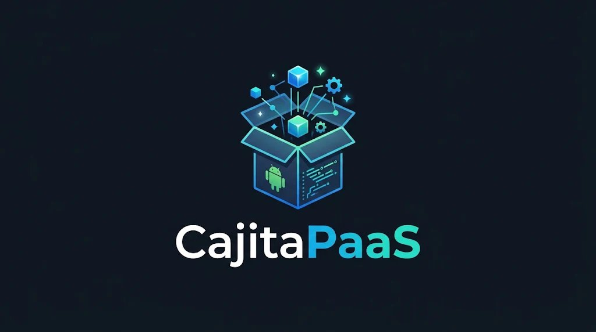

  

<h1 align="center">📦 CPS (CajitaPaaS)</h1>

  <b>Convierte cualquier teléfono Android en tu propio servidor de Internet gratis y sin complicaciones.</b>

  
  &nbsp;
  

---

## 🤔 ¿Qué es esto? (Explicado fácil y sin palabras raras)

Imagina que creaste una **página web**, una **app para tus amigos**, un **bot de Discord** o una **base de datos** para un proyecto del colegio. Normalmente, para que otras personas puedan entrar desde sus casas por Internet, tendrías que **alquilar una computadora en la nube** (un "servidor") y pagar todos los meses en dólares.

  **¿Y si pudieras usar ese celular Android que tienes guardado en un cajón como si fuera un servidor profesional?** 📱⚡

Eso es **CPS (`CajitaPaaS`)**: una aplicación que instalas en tu teléfono Android y que, por dentro, arma automáticamente una "cajita mágica" capaz de:

1. 🌐 **Publicar tus páginas web y proyectos en Internet** en segundos, dándote un link público seguro (`https://...`) sin que tengas que configurar el router de tu casa.
2. 🔄 **Actualizar sin que nada se caiga (Sistema Azul/Verde)**: Si subes una versión nueva de tu página y tiene un error, nadie se queda sin servicio. La app prepara la versión nueva al lado de la anterior y cambia el tráfico en un parpadeo.
3. 🗄️ **Guardar datos de verdad**: Trae su propia base de datos lista para usar y un botón para conectarte desde tu compu cuando quieras ver o editar la información.
4. 🔋 **No se duerme al apagar la pantalla**: Aunque bloquees el celular para no gastar batería en la pantalla, el servidor sigue encendido 24/7 conectado al Wi-Fi.

---

## 📲 Descargar e Instalar la APK en tu Celular

Tienes **dos formas** de descargar el instalador para tu teléfono Android:

### Opción 1: Descarga Directa (1 clic) ⚡

👉 **[Haz clic aquí para descargar `CajitaPaaS-CPS-ARM64.apk`](https://github.com/fernandoariasprogramador-code/CajitaPasS/releases/latest/download/CajitaPaaS-CPS-ARM64.apk)** _(o entra a la sección [Releases](https://github.com/fernandoariasprogramador-code/CajitaPasS/releases))_.

### Opción 2: Descargar desde GitHub Actions 🛠️

1. Entra a **[GitHub Actions — Build CPS Android APK](https://github.com/fernandoariasprogramador-code/CajitaPasS/actions/workflows/build-apk.yml)**.
2. Toca la primera ejecución de la lista (la que tiene el check verde ✅).
3. Baja hasta el final donde dice **Artifacts** y toca **`CajitaPaaS-CPS-ARM64-APK`** para bajar el archivo.

---

## 🚀 ¿Cómo se usa paso a paso?

1. **Instala la APK** en tu celular Android (si el teléfono te pregunta _"¿Permitir instalar aplicaciones de esta fuente?"_, dale a **Permitir**).
2. **Abre la app `CPS`**: Verás que aparece un ícono pequeño en la barra de arriba de tu celular diciendo que el motor está encendido.
3. **Crea tu contraseña de dueño**: La primera vez que entres, la app te pedirá inventar una contraseña para que solo tú puedas controlar tu servidor.
4. **¡Listo! Ya estás dentro del Panel de Control**:
   - Desde tu mismo celular (o desde la compu entrando a la dirección Wi-Fi que te muestra la app) puedes **subir tus proyectos en `.zip` o desde GitHub**, ver cuánta memoria usan y compartir tu link de Internet con quien quieras.

---

## 🛠️ Resumen Técnico (Para curiosos y programadores)

Si más adelante quieres saber cómo funciona el motor por debajo, **CPS (`CajitaPaaS`)** combina:

- **Arquitectura Dual Inteligente en Android (ARM64)**:
  - **Modo Sin Root (Para cualquier celular normal)**: Usa `PRoot` + contenedor ligero Debian ARM64 + `PM2` + `MariaDB`.
  - **Modo Con Root (Avanzado)**: Si detecta acceso Root y soporte en el chip, activa contenedores reales con aislamiento `cgroups` y `Docker`.
- **Salida a Internet Segura**: Combina **Caddy Server** + **Cloudflare Tunnels (`cloudflared`)** integrado dentro de la APK para crear enlaces HTTPS públicos sin abrir puertos en el módem.
- **Puente Seguro para Base de Datos**: Permite conectar programas de escritorio como **DBeaver** a la base de datos del celular solo mientras tú lo autorices con un temporizador automático.

### Estructura del Proyecto

- [`android/app/src/main/AndroidManifest.xml`](android/app/src/main/AndroidManifest.xml): Permisos de servidor en segundo plano (`ForegroundService`, `WAKE_LOCK`) y extracción de binarios ARM64 (`extractNativeLibs="true"`).
- [`android/app/src/main/java/com/cajitapaas/ui/MainActivity.kt`](android/app/src/main/java/com/cajitapaas/ui/MainActivity.kt): Pantalla principal de la app que enciende el servidor y abre el Panel Web integrado.
- [`android/app/src/main/java/com/cajitapaas/core/EmbeddedControlPlaneServer.kt`](android/app/src/main/java/com/cajitapaas/core/EmbeddedControlPlaneServer.kt): Servidor HTTP nativo en Kotlin (puerto `4000`) que sirve el panel administrativo y la API dentro del teléfono.
- [`android/app/src/main/java/com/cajitapaas/core/PaaSRuntimeService.kt`](android/app/src/main/java/com/cajitapaas/core/PaaSRuntimeService.kt): Servicio persistente con `WakeLock` de CPU, `WifiLock` de baja latencia y túnel Cloudflare integrado.
- [`android/app/src/main/java/com/cajitapaas/core/RootDetector.kt`](android/app/src/main/java/com/cajitapaas/core/RootDetector.kt): Detector automático del modo del teléfono (Normal vs Root).
- [`control-plane/public/index.html`](control-plane/public/index.html) y [`control-plane/server.js`](control-plane/server.js): Interfaz visual y motor de despliegues Blue/Green sin caídas.
