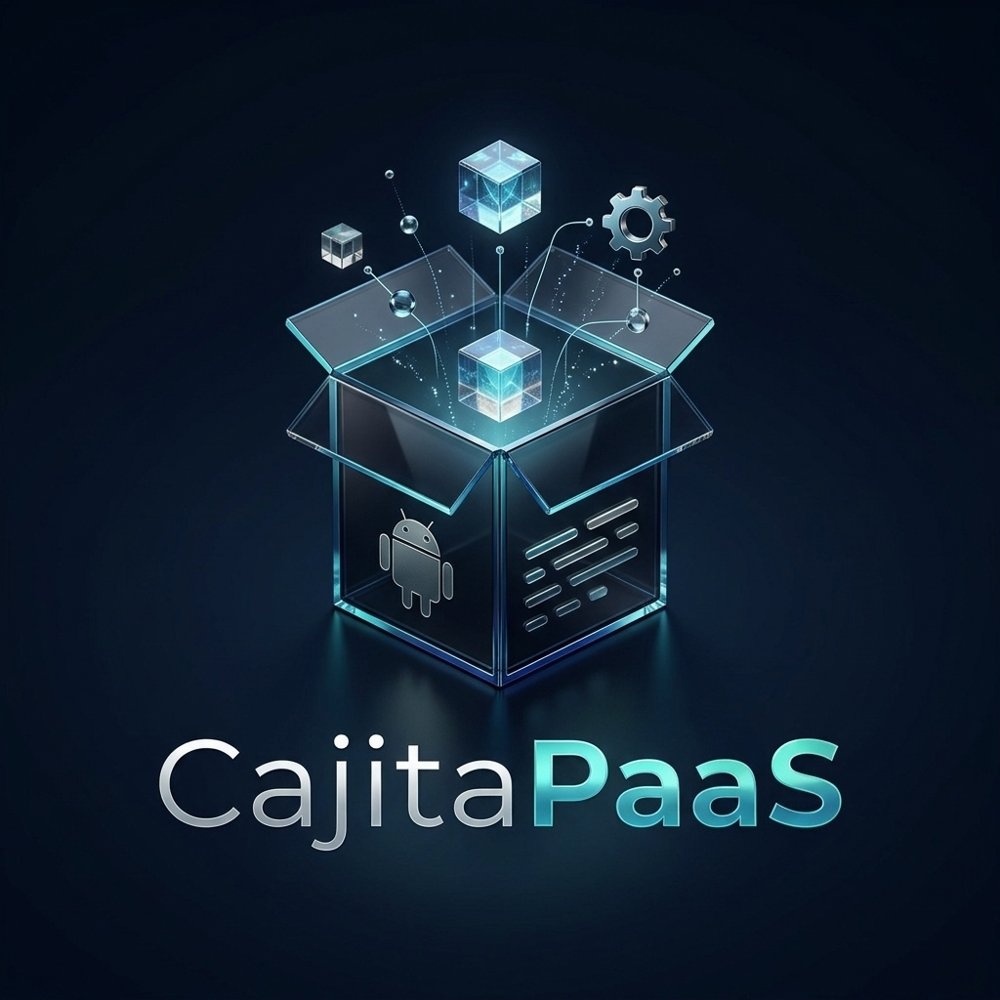

<p align="center">
  
</p>

<h1 align="center">📦 CPS (CajitaPaaS)</h1>
<p align="center">
  <b>Convierte cualquier teléfono Android en tu propio servidor de Internet gratis y sin complicaciones.</b>
</p>

<p align="center">
  <a href="https://github.com/fernandoariasprogramador-code/CajitaPasS/releases/latest/download/CajitaPaaS-CPS-ARM64.apk">
    
  </a>
  &nbsp;
  <a href="https://github.com/fernandoariasprogramador-code/CajitaPasS/actions/workflows/build-apk.yml">
    
  </a>
</p>

---

## 🤔 ¿Qué es esto? (Explicado fácil y sin palabras raras)

Imagina que creaste una **página web**, una **app para tus amigos**, un **bot de Discord** o una **base de datos** para un proyecto del colegio. Normalmente, para que otras personas puedan entrar desde sus casas por Internet, tendrías que **alquilar una computadora en la nube** (un "servidor") y pagar todos los meses en dólares.

**¿Y si pudieras usar ese celular Android que tienes guardado en un cajón como si fuera un servidor profesional?** 📱⚡

Eso es **CPS (`CajitaPaaS`)**: una aplicación que instalas en tu teléfono Android y que, por dentro, arma automáticamente una "cajita mágica" capaz de:

1. 🌐 **Publicar tus páginas web y proyectos en Internet** en segundos, dándote un link público seguro (`https://...`) sin que tengas que configurar el router de tu casa.
2. 🔄 **Actualizar sin que nada se caiga (Sistema Azul/Verde)**: Si subes una versión nueva de tu página y tiene un error, nadie se queda sin servicio. La app prepara la versión nueva al lado de la anterior y cambia el tráfico en un parpadeo.
3. 🗄️ **Guardar datos de verdad**: Trae su propia base de datos lista para usar y un botón para conectarte desde tu compu cuando quieras ver o editar la información.
4. 🔋 **No se duerme al apagar la pantalla**: Aunque bloquees el celular para no gastar batería en la pantalla, el servidor sigue encendido 24/7 conectado al Wi-Fi.
5. 📡 **Supervivencia de Red Wi-Fi (Opcional en Modo Root)**: Si el router Wi-Fi de tu casa o local se apaga, el celular puede encender su propia **Zona Wi-Fi (Hotspot)** automáticamente para que nadie pierda conexión local, y volver a conectarse solo cuando el router regrese _(viene deshabilitado por defecto y puedes activarlo con un clic desde el Panel Web)_.

---

## 📲 Descargar e Instalar la APK en tu Celular

Tienes **dos formas** de descargar el instalador para tu teléfono Android:

### Opción 1: Descarga Directa (1 clic) ⚡

👉 **[Haz clic aquí para descargar `CajitaPaaS-CPS-ARM64.apk`](https://github.com/fernandoariasprogramador-code/CajitaPasS/releases/latest/download/CajitaPaaS-CPS-ARM64.apk)** _(o entra a la sección [Releases](https://github.com/fernandoariasprogramador-code/CajitaPasS/releases))_.

### Opción 2: Descargar desde GitHub Actions 🛠️

1. Entra a **[GitHub Actions — Build CPS Android APK](https://github.com/fernandoariasprogramador-code/CajitaPasS/actions/workflows/build-apk.yml)**.
2. Toca la primera ejecución de la lista (la que tiene el check verde ✅).
3. Baja hasta el final donde dice **Artifacts** y toca **`CajitaPaaS-CPS-ARM64-APK`** para bajar el archivo.

---

## 🚀 ¿Cómo se usa paso a paso?

1. **Instala la APK** en tu celular Android (si el teléfono te pregunta _"¿Permitir instalar aplicaciones de esta fuente?"_, dale a **Permitir**).
2. **Abre la app `CPS`**: Verás que aparece un ícono pequeño en la barra de arriba de tu celular diciendo que el motor está encendido.
3. **Crea tu contraseña de dueño**: La primera vez que entres, la app te pedirá inventar una contraseña para que solo tú puedas controlar tu servidor.
4. **¡Listo! Ya estás dentro del Panel de Control**:
   - Desde tu mismo celular (o desde la compu entrando a la dirección Wi-Fi que te muestra la app) puedes **subir tus proyectos en `.zip` o desde GitHub**, ver cuánta memoria usan y compartir tu link de Internet con quien quieras.

---

## 🔌 Puertos Expuestos y Cómo Conectar tu Frontend con tu API

Cuando subes tus proyectos desde el Panel de Control, **CPS** organiza y expone automáticamente los puertos en tu red local Wi-Fi y en el Túnel Público de Cloudflare:

| Servicio / Rol                                | Puerto en Red Local (Wi-Fi)                                 | Ruta en el Túnel Público (`https://*.trycloudflare.com`) | Descripción                                                                                                                                  |
| :-------------------------------------------- | :---------------------------------------------------------- | :------------------------------------------------------- | :------------------------------------------------------------------------------------------------------------------------------------------- |
| **🎨 Frontend o App Monolítica (Fullstack)**  | **`:8080`** _(y **`:80`** directo si tienes Root)_          | `/` _(Raíz principal del link)_                          | Sirve tu página web principal lista para el público (ej. `http://192.168.1.4:8080` o `http://192.168.1.4` con Root vía `iptables`).          |
| **⚙️ Backend / API (Separado)**               | **`:3001`**, **`:3003`**, etc. _(+ Gateway `:8080/api/_`)\* | `/api/*`                                                 | Cada Backend tiene su propio puerto dedicado en la LAN (ej. `http://192.168.1.4:3001`) y además se enruta bajo `/api/` en el puerto `:8080`. |
| **🛠️ Panel de Configuración CPS**             | **`:4000`**                                                 | `/_control/`                                             | Panel administrativo para gestionar tus despliegues desde cualquier PC o celular en tu Wi-Fi (`http://192.168.1.4:4000`).                    |
| **🗄️ Base de Datos MariaDB / Puente DBeaver** | **`:3306`** _(y `:13306` alternativo)_                     | _Solo Red Local (LAN)_                                   | Se abre en el puerto estándar MySQL/MariaDB al activar el puente en la pestaña **Base de Datos** para conectarte desde **DBeaver** o **MySQL Workbench**. |

> [!NOTE]
> **¿Por qué se usa `:8080` en celulares sin Root?** Por seguridad del sistema operativo Android (Linux Kernel), las aplicaciones sin permisos Root tienen prohibido abrir puertos menores a `1024` (como el puerto `80`). Por eso **`:8080`** funciona siempre en cualquier teléfono, y si tu equipo tiene **Root**, CPS crea automáticamente una regla NAT (`iptables`) para que entrar a `http://<IP_DEL_CELULAR>` (puerto `80`) redirija de forma transparente al `:8080`.

---

### 🔗 ¿Cómo hago para que mi Frontend y mi API se conecten e interactúen?

Si subes un **Frontend** (React, Vue, HTML/JS) y un **Backend API** por separado, tienes **3 formas** de conectarlos sin preocuparte por cabeceras CORS ni por qué IP le tocó al celular hoy:

#### Opción 1: Usar rutas relativas `/api/...` (Recomendada ⭐)

El servidor Gateway de CPS (en el puerto `:8080` y en el enlace HTTPS del túnel de Cloudflare) une automáticamente ambos mundos bajo el mismo dominio:

- Todo lo que pidas a `/` carga los archivos de tu **Frontend**.
- Todo lo que tu Frontend pida a **`/api/...`** se redirige internamente al **Backend API** que hayas subido.

```javascript
// Ejemplo en tu Frontend: funciona igual en Wi-Fi local y en el link público de Cloudflare
const res = await fetch("/api/usuarios");
const data = await res.json();
```

#### Opción 2: Puente Automático para proyectos que ya apuntan a `localhost` (Sin tocar tu código 🪄)

Si ya compilaste tu proyecto apuntando a `http://localhost:3001` o `http://127.0.0.1:3000`, **no necesitas recompilarlo**. Al servir tu `index.html`, CPS inyecta un puente ligero que intercepta las llamadas `fetch` y `XMLHttpRequest` dirigidas a `localhost`:

- Si alguien entra desde tu red Wi-Fi (`http://192.168.1.4:8080`), redirige la petición automáticamente a la IP real del teléfono y al puerto de tu Backend (`http://192.168.1.4:3001/...`).
- Si alguien entra desde Internet por el túnel seguro (`https://xxxx.trycloudflare.com`), la redirige automáticamente a `/api/...` por HTTPS para evitar bloqueos de contenido mixto (_Mixed Content_).

#### Opción 3: Variable global `window.CPS_API_URL`

Si prefieres leer la URL base de la API desde una variable dinámica en tu JavaScript, CPS expone automáticamente en el navegador:

- `window.CPS_API_URL`: Apunta al puerto directo de tu API cuando navegas en red local (ej. `http://192.168.1.4:3001`) o a `/api` cuando navegas por el túnel HTTPS.
- `window.CPS_GATEWAY_API_URL`: Apunta siempre al proxy unificado `/api` del origen actual.

---

## 🛠️ Resumen Técnico (Para curiosos y programadores)

Si más adelante quieres saber cómo funciona el motor por debajo, **CPS (`CajitaPaaS`)** combina:

- **Arquitectura Dual Inteligente en Android (ARM64)**:
  - **Modo Sin Root (Para cualquier celular normal)**: Usa `PRoot` + contenedor ligero Debian ARM64 + `PM2` + `MariaDB`.
  - **Modo Con Root (Avanzado)**: Si detecta acceso Root y soporte en el chip, activa contenedores reales con aislamiento `cgroups` y `Docker`.
- **Salida a Internet Segura**: Combina **Caddy Server** + **Cloudflare Tunnels (`cloudflared`)** integrado dentro de la APK para crear enlaces HTTPS públicos sin abrir puertos en el módem.
- **Puente Seguro para Base de Datos**: Permite conectar programas de escritorio como **DBeaver** a la base de datos del celular solo mientras tú lo autorices con un temporizador automático.
- **Supervivencia de Red Wi-Fi (Failover a SoftAP / Failback a Router STA)**:
  - **Deshabilitado por defecto**: Se activa o desactiva bajo demanda desde la pestaña **🌐 3. Red, Túnel y Supervivencia Wi-Fi** del Panel Web.
  - **Conmutación Root Dinámica por SDK**: En Android 11+ (`API 30+`) utiliza `cmd tethering start-tethering 0` / `stop-tethering 0`; en Android 10 e inferiores (`API 29-`) inyecta transacciones Binder mediante `service call connectivity`.
  - **Sondeo en Modo Ciego (Single-Radio Polling)**: Diseñado para hardware con una sola antena (`wlan0`, ej. Moto G8) que no soporta concurrencia AP+STA. Cada `X` minutos configurables (5, 10, 15 o 30 min), apaga temporalmente el Hotspot, enciende el receptor Wi-Fi durante 30 segundos para verificar si volvió el router y, si aún no responde, re-levanta la Zona Wi-Fi de emergencia.

### Estructura del Proyecto

- [`android/app/src/main/AndroidManifest.xml`](android/app/src/main/AndroidManifest.xml): Permisos de servidor en segundo plano (`ForegroundService`, `WAKE_LOCK`), control de red/Wi-Fi (`ACCESS_NETWORK_STATE`, `CHANGE_WIFI_STATE`, `NEARBY_WIFI_DEVICES`) y extracción de binarios ARM64 (`extractNativeLibs="true"`).
- [`android/app/src/main/java/com/cajitapaas/ui/MainActivity.kt`](android/app/src/main/java/com/cajitapaas/ui/MainActivity.kt): Pantalla principal de la app que enciende el servidor y abre el Panel Web integrado.
- [`android/app/src/main/java/com/cajitapaas/core/EmbeddedControlPlaneServer.kt`](android/app/src/main/java/com/cajitapaas/core/EmbeddedControlPlaneServer.kt): Servidor HTTP multipuerto en Kotlin que sirve el Panel Administrativo (`:4000`), el Gateway Web público (`:8080`), los puertos dedicados por aplicación (`:3001+`) y el puente automático Frontend ↔ API.
- [`android/app/src/main/java/com/cajitapaas/core/EmbeddedDatabaseEngine.kt`](android/app/src/main/java/com/cajitapaas/core/EmbeddedDatabaseEngine.kt): Motor de base de datos relacional persistente con servidor de protocolo binario MySQL/MariaDB en los puertos `:3306` y `:13306` para conexión directa desde DBeaver.
- [`android/app/src/main/java/com/cajitapaas/core/PaaSRuntimeService.kt`](android/app/src/main/java/com/cajitapaas/core/PaaSRuntimeService.kt): Servicio persistente con `WakeLock` de CPU, `WifiLock` de baja latencia, redirección de puerto `80 -> 8080` en Root (`iptables`) y túnel Cloudflare integrado.
- [`android/app/src/main/java/com/cajitapaas/core/NetworkFailoverManager.kt`](android/app/src/main/java/com/cajitapaas/core/NetworkFailoverManager.kt): Gestor de Failover/Failback de red con `ConnectivityManager.NetworkCallback` y corrutina de sondeo para dispositivos de antena única.
- [`android/app/src/main/java/com/cajitapaas/core/RootShellUtils.kt`](android/app/src/main/java/com/cajitapaas/core/RootShellUtils.kt): Utilidad segura basada en `ProcessBuilder` para ejecutar comandos `su` capturando `stdout` y `stderr` de forma asíncrona con timeout.
- [`android/app/src/main/java/com/cajitapaas/core/RootDetector.kt`](android/app/src/main/java/com/cajitapaas/core/RootDetector.kt): Detector automático del modo del teléfono (Normal vs Root).
- [`control-plane/public/index.html`](control-plane/public/index.html) y [`control-plane/server.js`](control-plane/server.js): Interfaz visual, control de Supervivencia Wi-Fi y motor de despliegues Blue/Green sin caídas.
