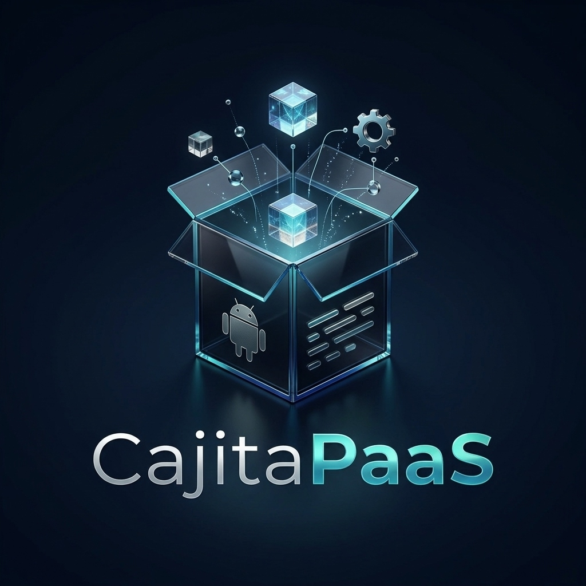

<p align="center">
  
</p>

<h1 align="center">📦 CPS (CajitaPaaS)</h1>
<p align="center">
  <b>Convierte cualquier teléfono Android en tu propio servidor PaaS de Internet gratis, autónomo y sin complicaciones.</b>
</p>

<p align="center">
  <a href="https://github.com/fernandoariasprogramador-code/CajitaPasS/releases/latest/download/CajitaPaaS-CPS-ARM64.apk">
    
  </a>
  &nbsp;
  <a href="https://github.com/fernandoariasprogramador-code/CajitaPasS/releases">
    
  </a>
  &nbsp;
  <a href="https://github.com/fernandoariasprogramador-code/CajitaPasS/actions/workflows/build-apk.yml">
    
  </a>
</p>

---

## 🤔 ¿Qué es esto? (Explicado fácil y sin palabras raras)

Imagina que creaste una **página web**, una **app con backend**, un **bot** o una **base de datos** para tu negocio o proyecto de estudio. Normalmente, para que otras personas puedan entrar desde cualquier lugar del mundo por Internet, tendrías que **alquilar un servidor en la nube** (AWS, Google Cloud, DigitalOcean, Heroku) y pagar todos los meses en dólares.

**¿Y si pudieras usar ese celular Android que tienes guardado en un cajón como si fuera un servidor profesional en la nube?** 📱⚡

Eso es **CPS (`CajitaPaaS`)**: una plataforma PaaS (Platform as a Service) nativa para Android que instalas en tu teléfono y que, por dentro, arma automáticamente una infraestructura completa capaz de:

1. 🌐 **Publicar tus proyectos en Internet al instante**: Te entrega un link público HTTPS seguro (`https://xxxx.trycloudflare.com`) sin tocar tu módem/router ni abrir puertos.
2. 🔄 **Actualizar sin caídas (Sistema Blue/Green)**: Puedes subir actualizaciones de tu app en vivo. La versión nueva se levanta en un slot paralelo y el tráfico conmuta de inmediato sin que tus usuarios noten interrupciones.
3. 🗄️ **Base de Datos MariaDB 10.11 Nativa con InnoDB**: Un motor relacional completo (no SQLite recortado) con transacciones ACID, catálogo `information_schema` y compatibilidad total con **DBeaver**, **MySQL Workbench** o **TablePlus** desde tu computadora en el puerto `:3306`.
4. ⚡ **Runtime Node.js v20 Nativo en ARM64**: Ejecuta directamente tus APIs en Node.js en el teléfono, con los módulos más populares ya preinstalados (`express`, `mariadb`, `mysql2`, `cors`, `dotenv`, `bcryptjs`, etc.).
5. 🔀 **Múltiples Bases de Datos Dinámicas**: Crea y asigna diferentes bases de datos (`cajitapaas`, `app_pruebas`, `tienda_db`) a cada backend desde el panel o cámbialas en caliente sin reinstalar.
6. 🔋 **Funciona 24/7 con Pantalla Apagada**: Integra bloqueos de energía (`PARTIAL_WAKE_LOCK` + `WIFI_MODE_FULL_LOW_LATENCY`) para evitar que el modo Doze de Android desconecte tus servicios.
7. 📡 **Supervivencia de Red Wi-Fi (Opcional en Modo Root)**: Si el router de tu casa se apaga, el celular puede levantar automáticamente una **Zona Wi-Fi (Hotspot)** de emergencia para que la red local siga funcionando.

---

## 📲 Descargar e Instalar la APK en tu Celular

Tienes **dos opciones** para descargar el instalador en tu teléfono Android (arquitectura ARM64):

### Opción 1: Descarga Directa (Recomendada) ⚡

👉 **[Haz clic aquí para descargar `CajitaPaaS-CPS-ARM64.apk`](https://github.com/fernandoariasprogramador-code/CajitaPasS/releases/latest/download/CajitaPaaS-CPS-ARM64.apk)** *(o entra a la sección de [Releases de GitHub](https://github.com/fernandoariasprogramador-code/CajitaPasS/releases))*.

### Opción 2: Descargar desde GitHub Actions 🛠️

1. Entra a **[GitHub Actions — Build CPS Android APK](https://github.com/fernandoariasprogramador-code/CajitaPasS/actions/workflows/build-apk.yml)**.
2. Toca la compilación más reciente con check verde ✅.
3. Baja hasta la sección **Artifacts** y descarga **`CajitaPaaS-CPS-ARM64-APK`**.

---

## 🚀 Guía Rápida de Uso

1. **Instala la APK** en tu teléfono Android (permite la instalación desde fuentes desconocidas si el sistema lo solicita).
2. **Abre la app `CPS`**: Verás la notificación del servicio en segundo plano indicando que el motor está activo.
3. **Crea tu contraseña de administrador**: En el primer inicio, define tu contraseña maestra para proteger el acceso.
4. **Ingresa al Panel de Control Web**:
   - Desde el navegador de tu computadora o del mismo celular, ingresa a `http://<IP_DE_TU_CELULAR>:4000` (la app te muestra la IP en pantalla, ej: `http://192.168.1.145:4000`).
5. **¡Listo!** Ya puedes subir tus proyectos en formato `.zip` y gestionarlos visualmente.

---

## 📦 Cómo Empaquetar y Desplegar tus Proyectos (.ZIP)

El panel de CajitaPaaS te permite desplegar dos tipos de aplicaciones: **Frontend** y **Backend API**.

### 1. Desplegar un Frontend (HTML, React, Vue, Vite, Angular)

- **Qué comprimir**: Genera la compilación de producción de tu frontend (`npm run build` o `pnpm build`) y comprime los archivos que están dentro de la carpeta `dist/` o `build/` (donde reside el archivo `index.html` principal).
- **Cómo subir**: En el panel, selecciona la pestaña **Subir Frontend**, asigna un nombre (ej. `tienda-front`), elige tu archivo `.zip` y presiona **Desplegar**.
- **Resultado**: Tu frontend estará accesible en tu red local en `http://<IP_CELULAR>:8080/` y en la raíz del túnel público HTTPS (`https://xxxx.trycloudflare.com/`).

---

### 2. Desplegar un Backend API (Node.js)

- **Qué comprimir**: Comprime tus archivos fuente: `server.js` (o `index.js`, `app.js`), tus carpetas de rutas (`routes/`), controladores (`controllers/`), modelos (`models/`), y tu `package.json` o `.env` (si los tienes).

> [!WARNING]
> ### ⚠️ REGLA DE ORO: ¡NUNCA INCLUYAS LA CARPETA `node_modules` EN EL ZIP!
>
> ❌ **No subas `node_modules` en tu archivo `.zip`**.
>
> **¿Por qué?**
> 1. **Incompatibilidad de Arquitectura**: Los módulos con binarios nativos compilados en tu PC (Windows o Mac x86_64) fallarán al ejecutarse en el procesador ARM64 de tu teléfono Android.
> 2. **Peso Innecesario**: Subir 100 MB o 300 MB de módulos ralentiza innecesariamente la subida y satura la memoria del celular.
> 3. **CajitaPaaS ya incluye los paquetes preinstalados**: El motor de CPS viene equipado de fábrica con los paquetes más populares optimizados para ARM64.

#### 📚 Módulos Node.js incluidos de fábrica en CajitaPaaS:

| Categoría | Módulos Preinstalados en el Runtime |
| :--- | :--- |
| **Bases de Datos** | `mariadb`, `mysql2`, `mysql` |
| **Framework & Web** | `express`, `cors`, `dotenv`, `axios`, `multer` |
| **Autenticación & Seguridad** | `jsonwebtoken`, `bcryptjs`, `bcrypt` |
| **Utilidades** | `uuid`, `path`, `fs`, `crypto`, `http`, etc. |

Si tu proyecto utiliza estos paquetes en sus `require(...)` o `import`, **funcionarán inmediatamente sin necesidad de subirlos ni instalarlos**.

---

### 📝 Ejemplo mínimo de Backend API (`server.js`)

CajitaPaaS inyecta automáticamente variables de entorno en el proceso de tu API. Puedes usarlas directamente con `process.env`:

```javascript
// server.js
const express = require('express');
const mariadb = require('mariadb');
const cors = require('cors');

const app = express();
app.use(cors());
app.use(express.json());

// Variables automáticas inyectadas por CajitaPaaS:
const pool = mariadb.createPool({
  host: process.env.DB_HOST || '127.0.0.1',
  port: Number(process.env.DB_PORT) || 3306,
  user: process.env.DB_USER || 'cajita_admin',
  password: process.env.DB_PASSWORD || 'cajitapaas2026',
  database: process.env.DB_NAME || 'cajitapaas',
  connectionLimit: 5
});

// Endpoint de prueba de salud
app.get('/api/status', (req, res) => {
  res.json({
    status: 'online',
    app: process.env.CPS_APP_NAME || 'mi-api',
    db: process.env.DB_NAME || 'cajitapaas',
    timestamp: new Date().toISOString()
  });
});

// Endpoint que consulta la base de datos
app.get('/api/tareas', async (req, res) => {
  let conn;
  try {
    conn = await pool.getConnection();
    const rows = await conn.query('SELECT * FROM tareas');
    res.json(rows);
  } catch (err) {
    res.status(500).json({ error: 'Error en base de datos', detalle: err.message });
  } finally {
    if (conn) conn.release();
  }
});

// Puerto asignado dinámicamente por CajitaPaaS (ej: 3001, 3003, etc.)
const PORT = process.env.PORT || 3001;
app.listen(PORT, '0.0.0.0', () => {
  console.log(`Backend API escuchando en el puerto ${PORT}`);
});
```

---

## 🗄️ Bases de Datos Dinámicas y Gestión con DBeaver

CajitaPaaS no te limita a una sola base de datos rígida. Soporta múltiples bases de datos relacionales independientes para cada una de tus aplicaciones.

### ¿Cómo asignar la base de datos de tu API?

Tienes **tres formas fáciles** de elegir a qué base de datos se conectará tu backend:

1. **Al Desplegar en el Panel Web**: En el formulario de subida del backend, completa el campo **"Base de Datos MySQL (Opcional)"** (ej. `app_pruebas` o `tienda_db`). CPS creará la base si no existe y configurará la variable `DB_NAME`.
2. **Mediante archivo `.env` en tu ZIP**: Si incluyes un `.env` en tu archivo comprimido con la línea:
   ```env
   DB_NAME=app_pruebas
   ```
   CajitaPaaS respetará tu configuración y conectará tu API a esa base.
3. **En caliente sin reinstalar ("🗄️ Cambiar BD")**: En la tarjeta de tu app encendida en el panel web, haz clic en el botón **"🗄️ Cambiar BD"**, escribe el nombre de la nueva base de datos y presiona Guardar. Tu API se reconectará al instante sin necesidad de volver a subir el archivo ZIP.

---

### 💻 Conexión desde tu PC con DBeaver o MySQL Workbench

Puedes administrar tus bases de datos, crear tablas, importar dumps `.sql` o revisar datos en tiempo real conectando tu cliente SQL favorito desde tu computadora:

1. En el Panel Web de CPS, ve a la pestaña **🗄️ Base de Datos**.
2. Presiona **Activar Puente DBeaver**.
3. En tu PC (en la misma red Wi-Fi), abre **DBeaver** o **MySQL Workbench** y crea una nueva conexión tipo **MySQL** o **MariaDB** con los siguientes datos:

| Parámetro | Valor de Conexión |
| :--- | :--- |
| **Host / Servidor** | La IP Wi-Fi de tu celular (ej: `192.168.1.145`) o `127.0.0.1` |
| **Puerto** | `3306` (o `13306`) |
| **Usuario** | `cajita_admin` |
| **Contraseña** | `cajitapaas2026` |
| **Base de Datos inicial** | `cajitapaas` |

> [!TIP]
> Desde DBeaver puedes ejecutar sentencias SQL completas, como crear nuevas bases de datos para tus distintas aplicaciones:
> ```sql
> CREATE DATABASE IF NOT EXISTS app_pruebas;
> USE app_pruebas;
> CREATE TABLE tareas (
>   id INT AUTO_INCREMENT PRIMARY KEY,
>   titulo VARCHAR(255) NOT NULL,
>   completada BOOLEAN DEFAULT FALSE,
>   creado_en TIMESTAMP DEFAULT CURRENT_TIMESTAMP
> );
> ```

---

## 🔌 Puertos Expuestos y Conexión Frontend ↔ API

Cuando tus aplicaciones están encendidas, **CPS** organiza los puertos en tu red local Wi-Fi y en el Túnel Público de Cloudflare:

| Servicio / Rol | Puerto en Red Local (Wi-Fi) | Ruta en Túnel Público (`https://*.trycloudflare.com`) | Descripción |
| :--- | :--- | :--- | :--- |
| **🎨 Frontend Principal** | **`:8080`** *(y `:80` en celulares con Root)* | `/` *(Raíz del enlace)* | Sirve tu interfaz web o SPA compilada. |
| **⚙️ Backend / API** | **`:3001`**, **`:3003`**, etc. *(y proxy en `:8080/api/`)* | `/api/*` | Cada backend tiene su puerto dedicado en la LAN y además un proxy unificado bajo `/api/` en el `:8080`. |
| **🛠️ Panel de Control CPS** | **`:4000`** | `/_control/` | Panel administrativo para desplegar, monitorear y gestionar el sistema. |
| **🗄️ Base de Datos MariaDB** | **`:3306`** *(y `:13306`)* | *Solo Red Local (LAN)* | Acceso directo de administración SQL para DBeaver o scripts locales. |

---

### 🔗 ¿Cómo conectar tu Frontend con tu Backend sin problemas de CORS?

Si despliegas un Frontend y una API por separado, puedes comunicarlos fácilmente con cualquiera de estas opciones:

#### Opción 1: Rutas relativas `/api/...` (Recomendada ⭐)
El Gateway interno de CajitaPaaS en el puerto `:8080` (y el túnel HTTPS de Cloudflare) unifica ambos servicios bajo el mismo origen:
```javascript
// Funciona idéntico en tu Wi-Fi local y a través de Internet
const res = await fetch("/api/tareas");
const tareas = await res.json();
```

#### Opción 2: Puente Automático de `localhost` (Sin modificar código)
Si tu Frontend ya fue compilado apuntando a `http://localhost:3001` o `http://127.0.0.1:3000`, CajitaPaaS inyecta un interceptor inteligente al servir el `index.html` que redirige dinámicamente esas peticiones a la IP real del celular en tu LAN o a la ruta segura `/api/` por HTTPS cuando se accede desde Internet.

#### Opción 3: Variables inyectadas en el navegador
CPS expone variables globales en el cliente:
- `window.CPS_API_URL`: Apunta a la dirección directa de tu backend.
- `window.CPS_GATEWAY_API_URL`: Apunta al proxy unificado `/api`.

---

## 🛠️ Arquitectura Técnica y Funcionamiento Interno

Para ingenieros, desarrolladores y curiosos del funcionamiento a bajo nivel:

```
┌────────────────────────────────────────────────────────────────────────┐
│                   DISPOSITIVO ANDROID (ARM64)                          │
│                                                                        │
│  ┌───────────────────────┐             ┌─────────────────────────────┐ │
│  │   Cloudflare Tunnel   │             │   PaaSRuntimeService        │ │
│  │  (libcloudflared.so)  │             │   - Foreground Service      │ │
│  └──────────┬────────────┘             │   - CPU Partial WakeLock    │ │
│             │ HTTPS Público            │   - WiFi Low-Latency Lock   │ │
│             ▼                          └──────────────┬──────────────┘ │
│  ┌────────────────────────────────────────────────────▼──────────────┐ │
│  │        EmbeddedControlPlaneServer (Kotlin Ktor/Netty)             │ │
│  │   - Panel Web (:4000)                                             │ │
│  │   - Gateway Reverse Proxy (:8080)                                 │ │
│  │   - Blue/Green Deployment Router & Health Checker                 │ │
│  └──────────┬─────────────────────────────────────────┬──────────────┘ │
│             │ Proxy /api/*                            │ Proxy /        │
│             ▼                                         ▼                │
│  ┌───────────────────────┐             ┌─────────────────────────────┐ │
│  │  Node.js v20 ARM64    │             │   Static Assets Storage     │ │
│  │  (libnode.so Alpine)  │             │   (HTML/CSS/JS Frontend)    │ │
│  │  - Preloader CJS      │             └─────────────────────────────┘ │
│  │  - Global node_modules│                                             │
│  └──────────┬────────────┘                                             │
│             │ Conexión TCP :3306                                       │
│             ▼                                                          │
│  ┌───────────────────────────────────────────────────────────────────┐ │
│  │   EmbeddedDatabaseEngine: MariaDB 10.11 ARM64 (InnoDB Nativo)      │ │
│  │   - Ejecución ELF nativa vía libc musl (libalpine_musl.so)        │ │
│  │   - Compatible con SELinux W^X en Android 10, 11, 12, 13, 14, 15  │ │
│  │   - Multi-Database (cajitapaas, app_pruebas, etc.)                │ │
│  │   - Listener en 0.0.0.0:3306 y 0.0.0.0:13306                     │ │
│  └───────────────────────────────────────────────────────────────────┘ │
└────────────────────────────────────────────────────────────────────────┘
```

- **Ejecución ELF Nativa sin Root ni PRoot Pesado**: Tanto MariaDB como Node.js se ejecutan directamente en el espacio de bibliotecas nativas de la aplicación (`extractNativeLibs="true"`), utilizando una capa de enlace Alpine musl (`libalpine_musl.so`) para satisfacer las llamadas al sistema Linux en Android respetando las restricciones de memoria W^X (Write XOR Execute).
- **Extracción de Assets de Alta Velocidad**: La inicialización del motor utiliza `ZipFile` nativo de C++ para descomprimir los componentes de MariaDB y las bibliotecas Node.js en segundos durante el primer arranque.
- **Preloader Node (`cps_node_preload.cjs`)**: Intercepta la resolución de módulos de Node.js mediante parcheo de `Module._resolveFilename` y `Module.globalPaths`, permitiendo que cualquier aplicación invoque `require('express')` o `require('mariadb')` desde la librería central compartida de CajitaPaaS.
- **Failover / Failback de Red (Supervivencia Wi-Fi)**: Monitorea el estado de la red mediante `ConnectivityManager.NetworkCallback`. En dispositivos con hardware de antena única (*single-radio*, ej: Moto G8), realiza ciclos de sondeo desactivando momentáneamente el Hotspot para verificar si el módem principal ha vuelto a encenderse.

---

## 📁 Estructura del Código Fuente

- [`android/app/src/main/AndroidManifest.xml`](android/app/src/main/AndroidManifest.xml): Configuración de servicios en primer plano, permisos de red, WakeLocks y empaquetado nativo.
- [`android/app/src/main/java/com/cajitapaas/core/EmbeddedControlPlaneServer.kt`](android/app/src/main/java/com/cajitapaas/core/EmbeddedControlPlaneServer.kt): Servidor multipuerto en Kotlin que maneja el Panel (`:4000`), el Gateway (`:8080`), la asignación de puertos dinámicos (`:3001+`), el proxy inverso y los endpoints de configuración de base de datos.
- [`android/app/src/main/java/com/cajitapaas/core/EmbeddedDatabaseEngine.kt`](android/app/src/main/java/com/cajitapaas/core/EmbeddedDatabaseEngine.kt): Gestor del ciclo de vida del motor MariaDB 10.11 ARM64 nativo y del runtime Node.js v20.
- [`android/app/src/main/java/com/cajitapaas/core/PaaSRuntimeService.kt`](android/app/src/main/java/com/cajitapaas/core/PaaSRuntimeService.kt): Servicio persistente de Android con bloqueos de suspensión (`WakeLock` y `WifiLock`) y orquestación del túnel Cloudflare.
- [`android/app/src/main/java/com/cajitapaas/core/NetworkFailoverManager.kt`](android/app/src/main/java/com/cajitapaas/core/NetworkFailoverManager.kt): Gestor de supervivencia de red con detección de caída de Wi-Fi y switch automático a Hotspot.
- [`control-plane/public/index.html`](control-plane/public/index.html) y [`control-plane/public/app.js`](control-plane/public/app.js): Interfaz de usuario interactiva del panel de control con soporte para despliegues Blue/Green, cambio de base de datos en caliente y monitoreo en tiempo real.

---

## 📄 Licencia

Este proyecto se distribuye bajo la licencia **MIT**. Eres libre de usarlo, modificarlo y adaptarlo para proyectos personales o comerciales.
